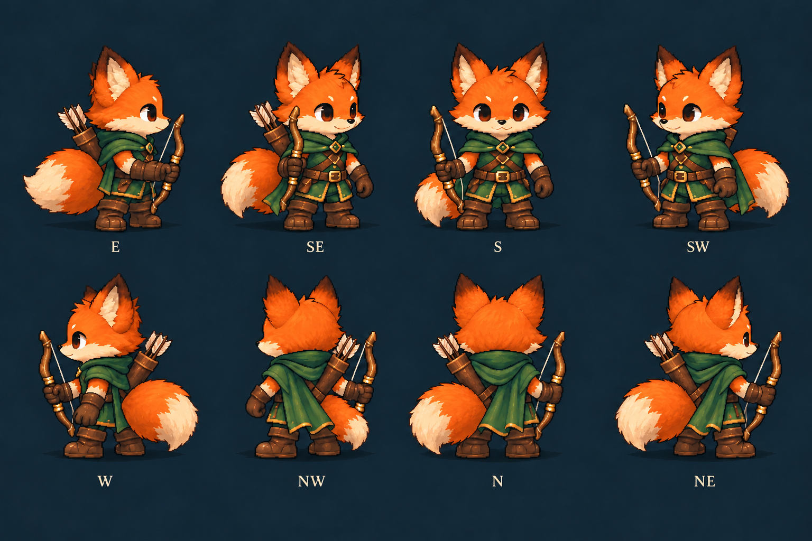
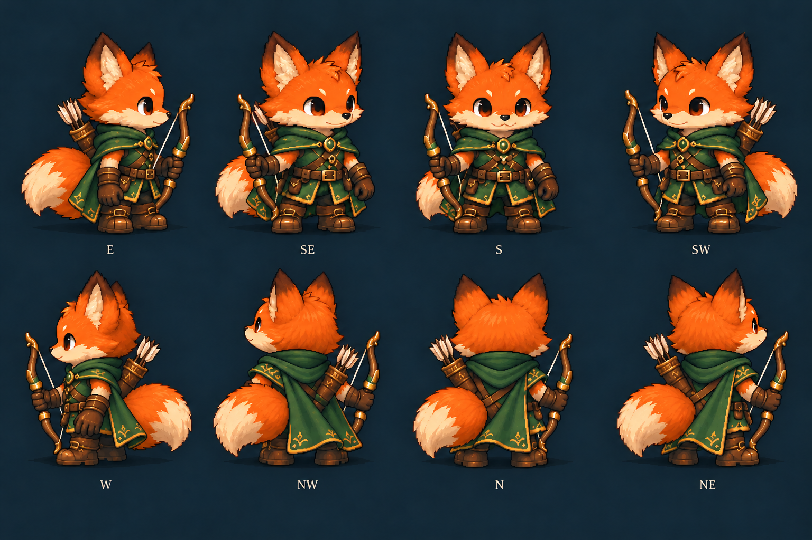
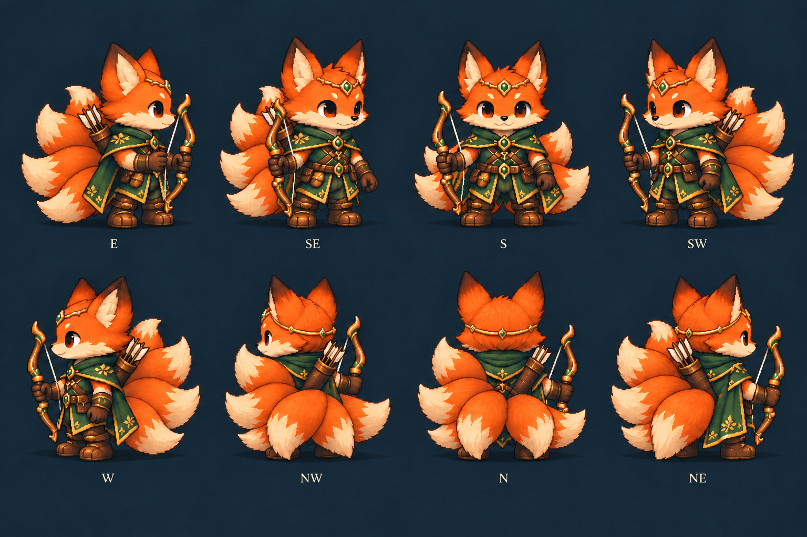

# Stocky fox art-direction preview

The user requested finer detail and stockier chibi legs/boots, with diagonal views as well as cardinal views. These are static art drafts for review before implementation. The existing moving pilot and production game are unchanged.

## Why the previous preview looked coarse

The motion pilot rasterized the character into a 64-by-64 buffer, reduced its painted colors to a 48-color indexed palette, and enlarged that buffer with nearest-neighbor sampling. That deliberately coarse rendering discarded much of the reference's shading and detail. Increasing the CSS display size cannot restore discarded source detail.

These 1536-by-1024 turnaround sheets retain the generated source resolution and fine shading. Each figure is roughly 350 pixels tall. They have not been reduced to 64-pixel cells or the pilot's 48-color palette. A future animation pass needs a higher-resolution raster buffer and corresponding painted-part registration while preserving logical gameplay coordinates; simply scaling the existing sprite will retain its coarse appearance.

## Art revision and coverage

- Short, thick thighs and lower legs; broad boots with rounded toes, substantial cuffs and thick soles.
- Compact torso and oversized head, with the legs/boots occupying approximately the bottom quarter of the standing silhouette.
- Existing orange/cream identity and green/leather costume progression retained as style references.
- Rowan/base and mature art each have one tail; Moontrail/apex has a five-tail fan with natural occlusion.
- Each sheet shows E, SE, S, SW on the top row and W, NW, N, NE on the bottom row. Actual rear quarters are depicted, rather than a rotated front sprite.
- Three authored art tiers are represented. Mature art is not an added gameplay evolution. Wild/Warden variants are not newly authored in this pass.

Original sources were inspected in all eight facings and three tiers using the [original sheet](../fox-layered-preview/original-directions.png). The [previous assembled comparison](../fox-layered-preview/original-current-enlarged.png) records the narrower legs and coarse animation raster being revised.

## Review sheets

### Rowan

### Mature art

### Moontrail Ranger / apex

## Review result and remaining work

Visually reviewed the three retained sheets at native image size and a fit-to-window size. The short broad legs, large boots, full standing silhouettes, costume progression and cardinal/diagonal art are present. Full-resolution PNG dimensions and SHA-256 provenance are recorded in [sources.json](sources.json); this is file verification, not a motion-quality test.

These sheets are **not approved equipment masters**. Repeated whole-sheet generative edits improved the front/rear bow side but did not reliably preserve every profile arm or bowstring. Known examples: mature E still reads as a far/left-hand carry; Moontrail E has the foreground hand on the string rather than a clean single right-hand grip; Rowan SE needs a clear complete bowstring. Those views require separately authored equipment/hand layers and fixed anatomical socket registration. Do not import these full-character drafts as validated right-hand bow assets, or keep regenerating the entire sheet to repair a single contact.

The stocky proportions are ready for art-direction feedback. The previous layered moving pilot still uses its original thin legs and 64-pixel renderer. Retargeting these proportions, creating layered directional kits, grip/string/arrow contacts, blink continuity, grounded gait, cape/tail dynamics, cell margins, and normal-speed motion review remain pending. None of the earlier moving pilot's test results validate these new static sheets.

No production renderer, source sprite module, gameplay rule, or offline HTML was changed. Production tests, offline rebuilds and source/offline combat checks apply when integration is authorized. This preview does not claim completion of those checks.

The reusable `layered-creature-art` skill now distinguishes source resolution, animation raster resolution and display scale, and records the fox's stocky-leg/boot preference. Repository and personal skill validation pass. [Exact generation and correction prompts](generation.md) are retained; built-in `image_gen` was used throughout.
