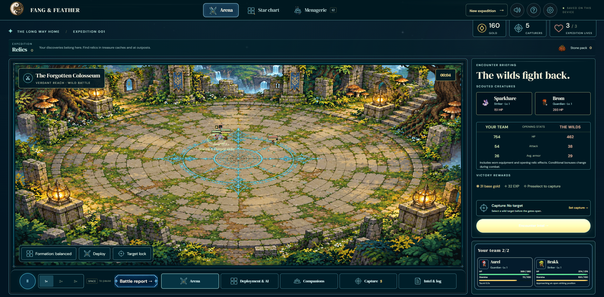
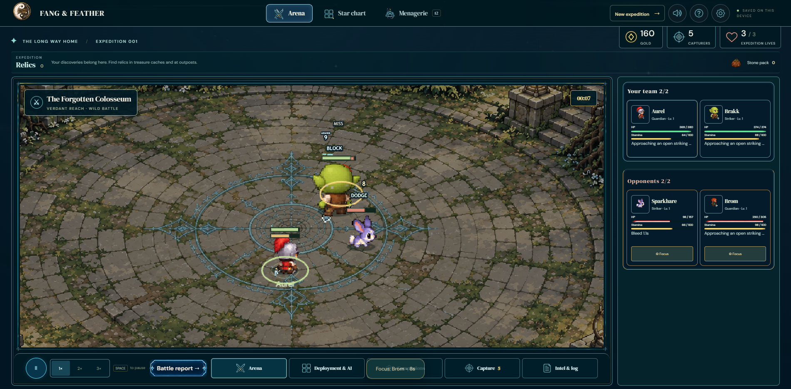
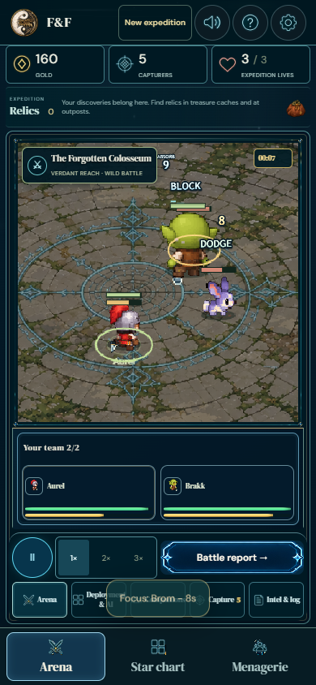

# Pass 1: readable combat

This pass improves battle scale/framing, impact feedback, collecting appeal in combat, mobile controls, pacing and scene consistency. It does not assign the entire game a 9/10 score.

## What changed

| Area | Delivered change | Evidence / limit |
| --- | --- | --- |
| Battle scale | Physical body scale rises from .15 to .4; bodies, weapons, mouths, ranges and collision volumes share that scale. Relative mass remains unchanged. | Actual painted alpha bounds measured in the live renderer at default tuning, rather than estimating from a 64px cell. |
| Framing | Smooth encounter framing retains living silhouettes and weapon margins; scenery follows the crop. Wide screens fill with artwork. | Camera/input round trips, fractional CSS canvas dimensions, live resizing and zoomed enemy targeting. |
| Combat feel | Source-silhouette hit tint, confirmed-hit heavy/critical pause and shake, distinct block audio, compact block/dodge/stagger/miss cues, aggregated hit numbers with a visibility budget. | Normal-speed source/offline recordings. Reduced motion suppresses the hit tint and inward camera zoom. |
| Clutter | Names and stamina/poise details appear for selected companions; health remains visible. Remove repeated focus labels and replace the static combat briefing with both live teams on desktop. | Desktop/phone screenshots. Bodies can still occlude each other during close combat. |
| Mobile | Compact resources, 44px-high speed/dock/portrait controls, tap-to-focus enemies and tap-to-inspect allies. Camera/input use CSS dimensions independently of backing-canvas density. | 390×844 phone at device scale 3; desktop at device scale 2; 2560px screen at scale 1. The renderer caps backing density at 2. |
| Pacing | Ordinary ranged fighters hold a clear firing position. Explicit retreat orders and the Longshot Codex retain kiting. Ordinary hits no longer pause the simulation. | Five opening encounters: **18.48s median**, individual durations **12.20–31.40s** at 1× simulation speed. Sustained fights still exceed 25 seconds. |
| Visual consistency | Crisp source pixels, quieter painted floor/rune, coherent contact shadows and fewer competing HUD marks. | Visual captures below; authored anatomy, indexed source palettes and attachment registrations are unchanged. |

## Visual review

Before this pass, default-size companions were lost beneath the rune and stacked labels:

Current desktop and phone captures:

Additional captures: [wide desktop](source-2560.png), [offline desktop](offline-1900.png), [offline phone](offline-390.png), [offline wide desktop](offline-2560.png), [phone before](before-phone.png). Before captures were taken around 5s at 1900×935 / 390×935; current captures are around 7.5s at 1900×935 / 390×844. They illustrate the presentation change, not matching animation poses.

Normal-speed recordings: [source desktop](source-1900.webm), [source phone](source-390.webm), [offline desktop](offline-1900.webm), [offline phone](offline-390.webm). Each includes actual 1× combat, focus input and a live viewport change. [Decoded video crops](decoded-desktop.png) / [enlarged phone crop](decoded-phone-2x.png) come from those encoded recordings.

See [browser measurements](browser.json) for each viewport's actual painted heights, default slider values, touch targets, camera and page errors. Source/offline results agree; the phone's painted median is about **55px**, and the 1900px desktop median about **89px**. These include the full painted silhouette, including carried equipment.

## Checks and coverage

- [79-test regression run](regression.txt): arena physics, creature motion, gait/carry, melee weapon artwork, tactics, tuning and feedback. [39-test contact/art run](contacts.txt): native expedition/lineage, prototype rig and pixel rendering. All pass.
- [Selected physical scale/contact/text checks](scale.txt): three pass. The old radius expectation used 22px even though the production footprint already used 44px; the updated default-scale test explicitly verifies `44 × .4`, the actor scale and melee range. No anatomy or contact tolerance was relaxed.
- [Final pipeline/camera contracts](pipeline-contracts.txt): eleven pass. [Pacing sample](pacing.json) passes its 15–25s median gate.
- [Ten source/offline layout checks](layout.json): 2560×1440, 1900×935, 1366×768, 1024×768 and 390×844; no horizontal overflow, usable dock placement and no page errors.
- [Live limb checks](legs-live.json): source/offline, 12 companions including evolved bear, crab, drake and stag; 50/150/100% stride settings, reset, moving combat and phone layout; no errors or offline external dependencies.
- [Training Glade checks](prototype-live.json): all nine locomotion profiles, all eight facings, seventeen inspectable animation states, physical travel, pause/stepping, charged actions and offline renderer checks.
- Both offline HTML builds were rebuilt and remain below 100 MiB. The complete seven-stage movie/parts export was not rerun: this pass changes presentation and physical scale, not source anatomy. Prior all-family/form/facing visual review remains in [the animation review](../animation-quality/README.md).

Opening battle recordings cover **Aurel, Brakk, Sparkhare and Brom**. Live limb checks additionally cover **Frostursa (2), Pyrehorn (0), Flintback (0), Mireclaw (2), Stormdrake (2), Cogwalker (0), Runespider (2), Orchimantis (2), Onyxscarab (2), Ironscolopendra (2), Nightmaw (2), Crownstag (2)**, with wild evolution paths. Recordings show the facings reached during combat; they do not claim a new eight-direction art audit of every family.

## Reproduce

Start `npm start`, then run `npm run review:combat`. This rebuilds the main offline game and executes the new contracts, pacing sample and six default-size browser scenes. `CHROMIUM_PATH` selects Chrome; `BASE_URL` selects the server; `PASS_ONE_OUT` selects the recording directory. The new checks also run in animation pipeline stage 7, independently of the general test suite.

These are focused checks, not a fresh full-suite or complete balance run. The pre-existing linked-counter suite failure reported in the earlier animation review was outside this pass and was not reclassified as passing.
